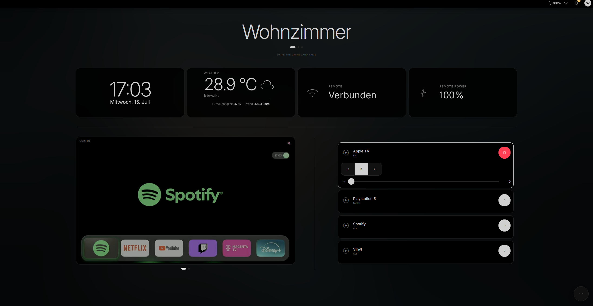
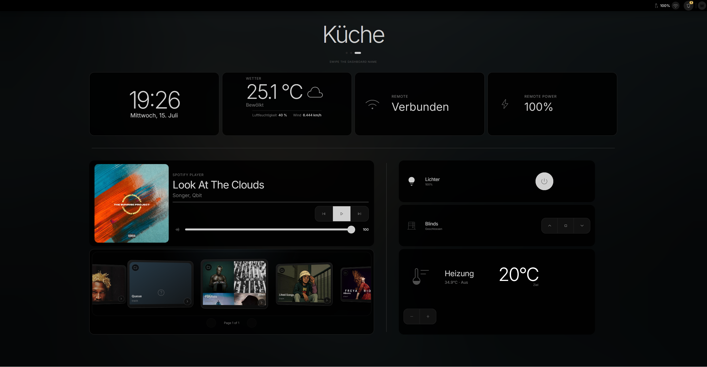
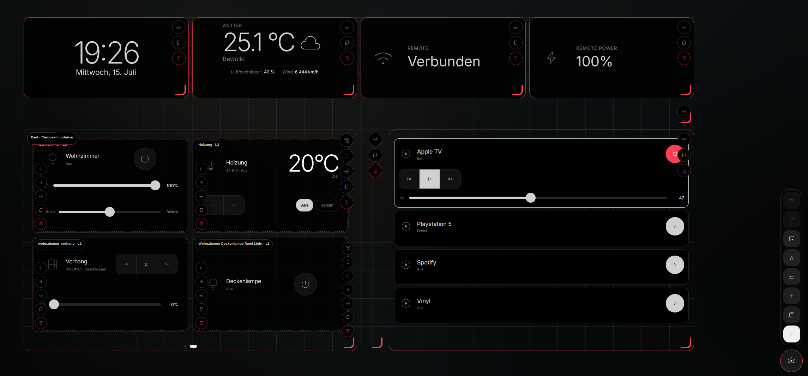
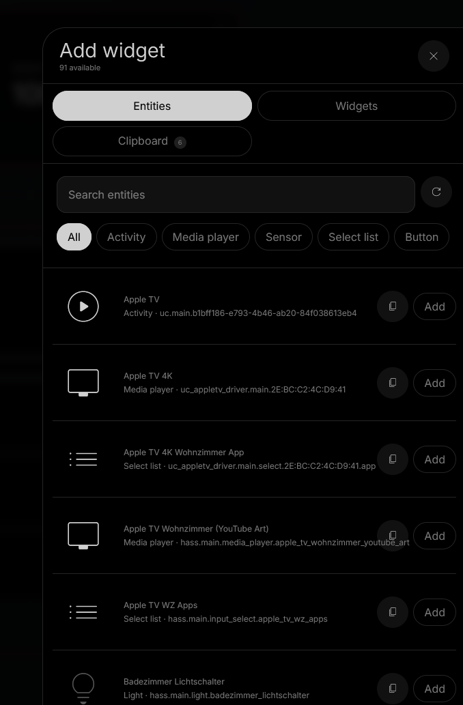
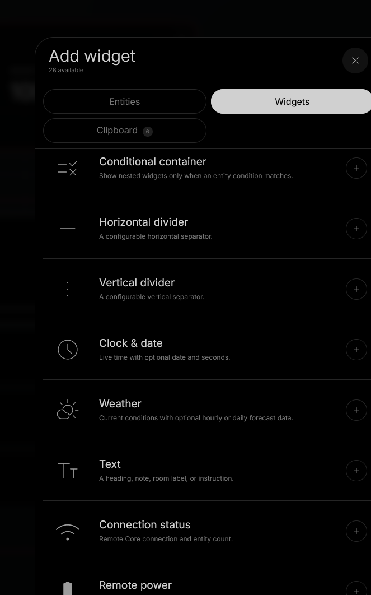
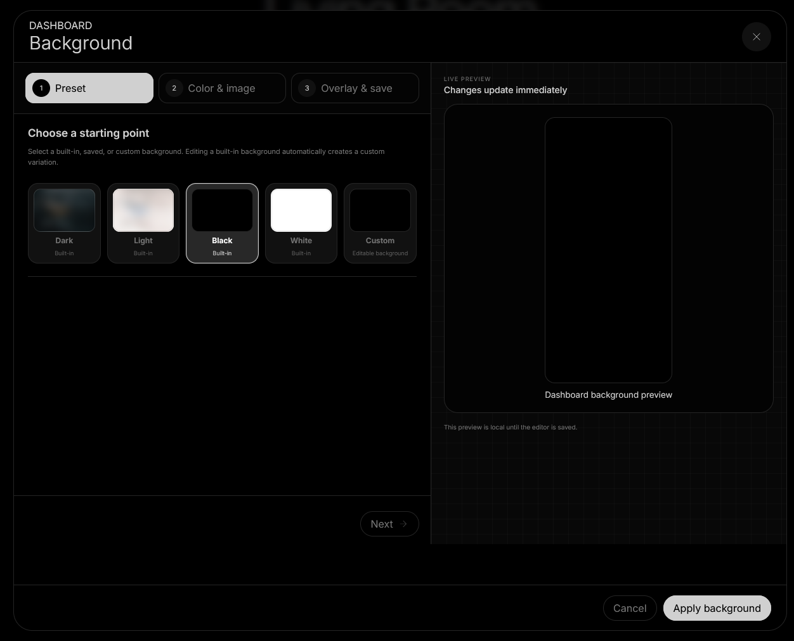
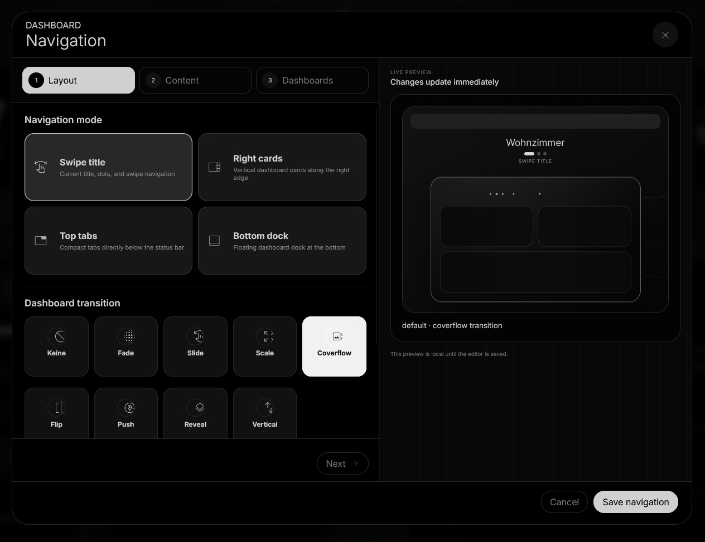
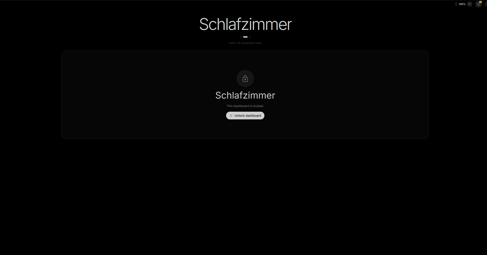

<div align="center">


# UC Dashboard

A responsive, fully customizable wall dashboard for **Unfolded Circle Remote Two and Remote 3**.

Run it directly on the Remote as an integration driver or deploy it externally with Docker.

[Installation](#installation) · [Docker](#docker-deployment) · [Screenshots](#screenshots) · [Backup and restore](#backup-and-restore)

</div>

> [!NOTE]
> Remote Two and Remote 3 are supported. The Remote Simulator is not supported.

## Overview

UC Dashboard connects to the Unfolded Circle Core API and provides persistent, responsive dashboards with live entity state, controls, media artwork, camera streams, navigation, kiosk mode, screensavers, and extensive visual customization.

## Screenshots

### Dashboard examples





### Dashboard editor



### Adding entities and widgets

<table>
<tr>
<td width="50%" valign="top">

</td>
<td width="50%" valign="top">

</td>
</tr>
</table>

### Background and navigation editors

<table>
<tr>
<td width="50%" valign="top">

</td>
<td width="50%" valign="top">

</td>
</tr>
</table>

### Dashboard lock



## Features

### Dashboard and layout

- Multiple dashboards with swipe, tabs, cards, or dock navigation
- Native responsive reflow and fixed-width scale-to-fit display modes
- Per-device layout variants
- Frozen off-screen dashboard state, including widget DOM, geometry, scroll position, and carousel state
- Optional dashboard title, status bar, navigation controls, and per-dashboard backgrounds
- Undo and redo while editing
- Nested conditional, tab, carousel, and entity-group containers

### Widgets

Supported Core entity types:

- `activity`
- `media_player`
- `sensor`
- `select`
- `button`
- `light`
- `climate`
- `cover`

Additional widgets include cameras, clocks, weather, room summaries, history graphs, alerts, text, gauges, scenes and routines, entity tables, counters, statistics, timers, templates, custom code, connection status, Remote power, dividers, and spacers.

### Kiosk and screensaver

- Full-screen kiosk mode
- Optional starting-dashboard routing
- Dashboard PIN locks stored as one-way hashes
- Browser-session unlock state
- Configurable inactivity relocking
- Clock or image screensavers
- Moving screensaver content without position jumps
- Entity-triggered screensaver widget panels
- Fully translated kiosk prompts and runtime messages

### Media and cameras

- Media artwork, metadata, progress, playback, and volume controls
- Native media browsing with search, pagination, grid, list, cards, and coverflow layouts
- go2rtc aliases and raw RTSP relay
- Snapshots, MJPEG, and browser-compatible HTTP video
- External FFmpeg relay for Docker deployments
- Camera crop, fit, poster, refresh, autoplay, mute, and control options

## Installation

### Install on a Remote

Download the integration archive from the [latest release](https://github.com/jstnjx/uc-dashboard/releases/latest).

On the Remote, open:

```text
Integrations & docks → Add new → Install custom
```

Enable **Update existing driver** when upgrading an existing installation, then upload the `.tar.gz` archive.

Open UC Dashboard at:

```text
http://REMOTE_IP:11080/
```

Kiosk mode:

```text
http://REMOTE_IP:11080/?kiosk
```

Open a specific dashboard by name or ID:

```text
http://REMOTE_IP:11080/?kiosk&p=Living%20Room
http://REMOTE_IP:11080/?kiosk&p=main
```

### Build from source

Node.js 22 is recommended. The project has no runtime dependencies, so there is nothing to install; the frontend bundle is built with esbuild through `npx`.

```bash
npm run check
npm run build:integration   # also runs build:frontend
```

Generated release files (the version comes from `driver.json`):

```text
builds/uc-dashboard-<version>.tar.gz
builds/uc-dashboard-<version>.tar.gz.sha256
```

## Docker deployment

```bash
docker compose up -d --build
```

Register the external integration on the Remote using:

```text
ws://HOST_IP:9090
```

The included Compose configuration uses host networking so the Remote can reach the Integration API and the integration can derive the Remote address from the incoming connection.

Persistent files:

```text
./config/settings.json
./data/dashboard.json
```

## Backup and restore

Open **Settings → Backup** to export or import a portable JSON backup.

Backups include:

- Dashboards and widgets
- Navigation and status-bar configuration
- Background and screensaver images
- Custom presets
- Notification rules
- Localization dictionaries
- Portable integration preferences

Core API keys, authentication data, browser-session unlocks, and browser-local clipboard contents are excluded.

Before importing a backup, UC Dashboard validates its structure and writes a timestamped safety copy of the active configuration to:

```text
data/backups/
```

Portable integration settings can be omitted during import when moving a dashboard to another Remote or host.

## OpenWeatherMap weather data

The Weather widget supports two data sources: **Remote / Home Assistant entities** (the existing default) or **OpenWeatherMap API**.

1. Obtain an API key from [OpenWeatherMap](https://home.openweathermap.org/api_keys).
2. In UC Dashboard, open **Settings → Weather** and save the API key. Alternatively set `OPENWEATHERMAP_API_KEY` on the integration server.
3. Edit a **Weather** widget and select **OpenWeatherMap API** as its data source.
4. Enter a city (for example `Berlin,DE`) or geographic coordinates. Select the desired units, layout, and number of forecast items.

The integration calls OpenWeatherMap's Current Weather API and free-plan-compatible 5-day / 3-hour Forecast API. Hourly and daily views share the existing weather widget styling. API data is cached for 10 minutes on the integration server, and browsers refresh periodically. The key remains in private integration settings and is **never sent to the dashboard browser or included in backups**.

The free APIs used here do not provide UV index data; UV remains available when the widget uses a compatible entity source. OpenWeatherMap's API availability and limits depend on your account plan.

## Camera configuration

For a named go2rtc stream, use:

```text
rtsp://GO2RTC_HOST:8554/STREAM_NAME
```

Or configure the values separately:

```text
go2rtc API URL:     http://GO2RTC_HOST:1984
go2rtc stream name: STREAM_NAME
```

Raw RTSP URLs can also be supplied to go2rtc dynamically. Generic RTSP through FFmpeg is available only for external deployments; Remote Two and Remote 3 require go2rtc for RTSP playback.

## Core API provisioning

During initial setup, UC Dashboard:

1. Authenticates once with the PIN shown by the Remote web configurator.
2. Creates an `admin`-scope Core API key.
3. Stores the key in the private integration configuration directory.
4. Discards the PIN without writing it to disk.
5. Reconnects using the generated API key.

Default on-Remote endpoints:

```text
REST:      http://127.0.0.1
WebSocket: ws://127.0.0.1/ws
```

## Ports

| Service | Default |
|---|---:|
| Integration API WebSocket | `9090` externally; assigned on Remote |
| UC Dashboard HTTP | `11080` |
| go2rtc HTTP/WebSocket API | `1984` |
| go2rtc RTSP output | `8554` |

## Environment variables

| Variable | Default | Description |
|---|---:|---|
| `UC_INTEGRATION_INTERFACE` | `0.0.0.0` | Integration API bind interface |
| `UC_INTEGRATION_HTTP_PORT` | `9090` externally | Integration API port |
| `DASHBOARD_HOST` | `0.0.0.0` | Dashboard bind address |
| `DASHBOARD_PORT` | `11080` | Dashboard HTTP port |
| `CHARGING_GATED` | `true` on Remote | Stop the dashboard listener while the Remote is not charging |
| `UC_CONFIG_HOME` | Runtime supplied | Persistent integration settings directory |
| `UC_DATA_HOME` | Runtime supplied | Persistent dashboard directory |
| `CONFIG_DIR` | `./config` | External settings directory |
| `DATA_DIR` | `./data` | External dashboard directory |
| `REMOTE_HTTP_URL` | Auto-detected | Advanced Core REST override |
| `REMOTE_WS_URL` | Auto-detected | Advanced Core WebSocket override |
| `REMOTE_API_KEY` | Provisioned | Advanced API-key override |
| `OPENWEATHERMAP_API_KEY` | Unset | Optional server-side OpenWeatherMap API key (overrides Settings → Weather) |
| `FFMPEG_PATH` | `ffmpeg` | FFmpeg executable for external RTSP relay |
| `UC_DASHBOARD_LOG_LEVEL` | `info` | `error`, `warn`, `info`, `debug`, or `trace` |

## Security

- The setup PIN is never persisted.
- The Core API key remains in private integration settings.
- Camera URLs may contain credentials and are stored in `dashboard.json`.
- Keep UC Dashboard and go2rtc on a trusted local network or behind an authenticated reverse proxy.
- Do not expose the Integration API or dashboard directly to the public internet.
- Custom HTML, CSS, and JavaScript widgets are intentionally not sandboxed. Only use code from trusted sources.

## Development

```bash
npm start
npm run check
npm run build:frontend
npm run build:integration
```

UC Dashboard uses structured JSON logging. Debug output includes connection, entity, media, camera, configuration, HTTP, and WebSocket activity while redacting API keys, PINs, authentication headers, credentials, cookies, sessions, and camera URLs.

## License

Released under the [MIT License](LICENSE).